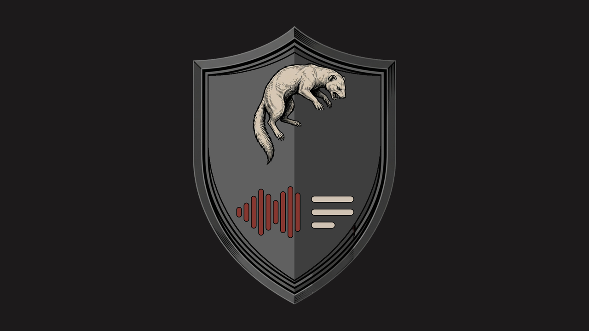

<p align="center">
  
</p>

<p align="center">
  <a href="https://t.me/chisto_text_bot"></a>
  
  <a href="LICENSE"></a>
</p>

<h3 align="center">Прислал голосовое — получил текст.</h3>

<p align="center">
  Голосовые, кружки, аудио и видео. Без рекламы, регистрации и «подпишись на 4 канала». Бесплатно.
</p>

<p align="center">
  <a href="https://t.me/chisto_text_bot"><b>Открыть бота: @chisto_text_bot</b></a>
  &nbsp;·&nbsp;
  <a href="#как-устроен">Как устроен</a>
  &nbsp;·&nbsp;
  <a href="#свой-сервер">Свой сервер</a>
  &nbsp;·&nbsp;
  <a href="#поддержать">Поддержать</a>
</p>

## Что умеет

- **Голосовые, кружки, аудио и видео** — прислать или переслать из любого чата. OGG, MP3, M4A, WAV, FLAC, MP4, MOV, WEBM и другие.
- **Русский с пунктуацией**: точки, запятые и заглавные ставит модель. Длинная запись приходит абзацами, очень длинная — файлом.
- **Другие языки** — бот сам замечает, что речь не русская, и отдаёт её Whisper.
- **Группы**: ответь на голосовое `/text` — пришлёт текст. Админ включает `/auto` — бот расшифровывает все голосовые и кружки сам, длинный текст сворачивает.
- **Длинные записи**: до 3 часов и до 2 ГБ (со своим сервером Bot API).

## Почему этому можно доверять

- **Запись никуда не уходит.** Распознавание — на своём сервере, без облачных API.
- **Ничего не хранится.** Расшифровал — удалил запись. Текст отправил и забыл. Базы данных нет: для лимитов бот помнит минуты в памяти, перезапуск всё стирает. Группы с `/auto` — только солёным хешем.
- **Чужой файл не опасен для сервера.** FFmpeg открывает только обычные аудио- и видеоконтейнеры и только с диска; длине из заголовка бот не верит и пересчитывает по распакованному звуку.
- **Весь код открыт** — два файла: [`tekst.py`](tekst.py) (бот) и [`speech.py`](speech.py) (распознавание).

## Как устроен

- **GigaAM v3 e2e RNN-T** (Сбер, MIT) через [onnx-asr](https://github.com/istupakov/onnx-asr), int8 — русская речь. Минута звука — около 2 секунд одного ядра.
- **Whisper small** через [faster-whisper](https://github.com/SYSTRAN/faster-whisper) — запасной для других языков. Загружается по требованию, выгружается после 15 минут без дела.
- **Нарезка по паузам.** GigaAM слушает куски до ~20 с: бот режет запись посреди самой длинной паузы между 10-й и 20-й секундой. Порог тишины считается относительно самой записи, поэтому работает и на шумной улице.
- **Очередь по кругу.** Распознавание — генератор: кусок звука, и ядро переходит к следующему человеку. Короткое голосовое не ждёт чужой часовой подкаст.

Замер на одном ядре сервера, 22 файла (отрывки подкаста «Подлодка» + синтетическая речь), WER на подкасте:

| Модель | WER / CER, % | Сек CPU на минуту | Память |
|---|---|---|---|
| **GigaAM v3 e2e RNN-T** | **7,9 / 3,9** | **2,2** | 521 МБ |
| faster-whisper turbo | 8,9 / 3,9 | 24,4 | 2131 МБ |
| faster-whisper small, beam 5 | 14,2 / 7,2 | 14,2 | 922 МБ |
| whisper.cpp small, beam 5 | 18,1 / 9,4 | 29,9 | 528 МБ |

Скрипты замера — [`tools/bench.py`](tools/bench.py) и [`tools/wer.py`](tools/wer.py).

## Ограничения, честно

- Не разделяет говорящих, не делает пересказ и субтитры.
- Другие языки — через Whisper small: заметно хуже, чем русский, и не длиннее 15 минут.
- Ядро одно: на человека 120 минут в час и 360 в сутки, на группу — 180 минут в час, одна запись — до 3 часов.
- Обычный Bot API отдаёт ботам файлы до 20 МБ. Больше — только со своим сервером `telegram-bot-api --local`.

## Свой сервер

Нужны Python 3.10–3.13, FFmpeg и ~700 МБ под модели.

```sh
git clone https://github.com/kozliq/tekst && cd tekst
python3 -m venv venv && venv/bin/pip install -r requirements.txt
tools/models.sh                      # GigaAM и Whisper с HuggingFace, со сверкой sha256
mkdir -p ~/.tekst && echo "ТОКЕН_ОТ_BOTFATHER" > ~/.tekst/bot.token
TEKST_DATA=~/.tekst TEKST_WORK=/tmp/tekst venv/bin/python tekst.py
```

Для Linux-сервера — готовые службы systemd с клеткой и потолками: [`deploy/tekst-bot.service`](deploy/tekst-bot.service) (бот, одно ядро, 1,5 ГБ) и [`deploy/tekst-tgapi.service`](deploy/tekst-tgapi.service) (свой сервер Bot API для файлов до 2 ГБ).

| Переменная | Что делает | По умолчанию |
|---|---|---|
| `TEKST_TOKEN` | токен бота (или файл `bot.token` в `TEKST_DATA`) | — |
| `TEKST_DATA` | папка для `bot.token`, настроек `/auto`, статистики и донатов | `~/Library/Application Support/Tekst` |
| `TEKST_WORK` | временные файлы записей | `~/Library/Caches/Tekst` |
| `TEKST_MODELS` | папка с моделями | `models/` рядом с кодом |
| `TEKST_THREADS` | потоков на распознавание | `1` |
| `TEKST_TG_API` | адрес Bot API (свой сервер Telegram) | `https://api.telegram.org` |
| `TEKST_TG_LOCAL` | `1` — свой сервер в режиме `--local`, файлы до 2 ГБ | — |
| `TEKST_TG_DIR` | где свой сервер Bot API держит скачанное | `/var/lib/tekst-tgapi` |
| `TEKST_PER_HOUR`, `TEKST_PER_DAY` | минут на человека в час и в сутки | `120`, `360` |

Аватарка: `python3 tekst.py avatar brand/avatar-640.jpg`. Имя, описание и команды бот ставит себе сам при запуске.

## Тесты

```sh
venv/bin/python -m unittest discover -s tests
```

Бот целиком на поддельном Telegram — от «прислал голосовое» до «пришёл текст»: кружки, MP3, английский, тишина, битые файлы, группы, `/auto`, лимиты, очередь. Речь для проверок говорит синтезатор macOS (`say`), поэтому часть тестов идёт только на Маке.

## Поддержать

Бот бесплатный и таким останется. Сказать спасибо можно звёздочкой — командой `/donate` в боте. Это добровольно и ни на что не влияет; передумал — `/paysupport`, звёзды вернутся.

## Ещё от нас

- [**Кружок**](https://github.com/kozliq/krugi) — делает из видео кружок для Telegram.
- [**Качалка**](https://github.com/kozliq/kachalka) — сохраняет видео из YouTube, TikTok и VK без водяных знаков.
- [**Чисто**](https://github.com/kozliq/chisto) — убирает рекламу и слежку на телефоне и компьютере.

Лицензия — [MIT](LICENSE). Модели — под своими лицензиями: GigaAM — MIT, Whisper — MIT.
